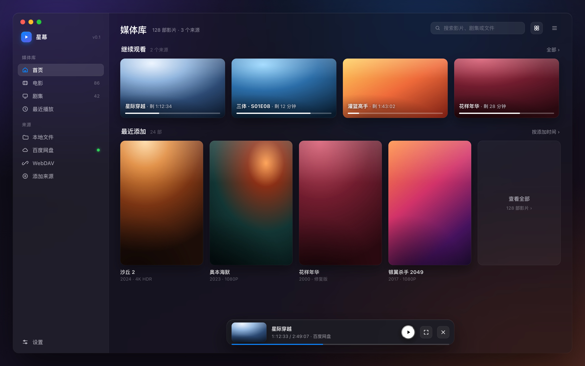
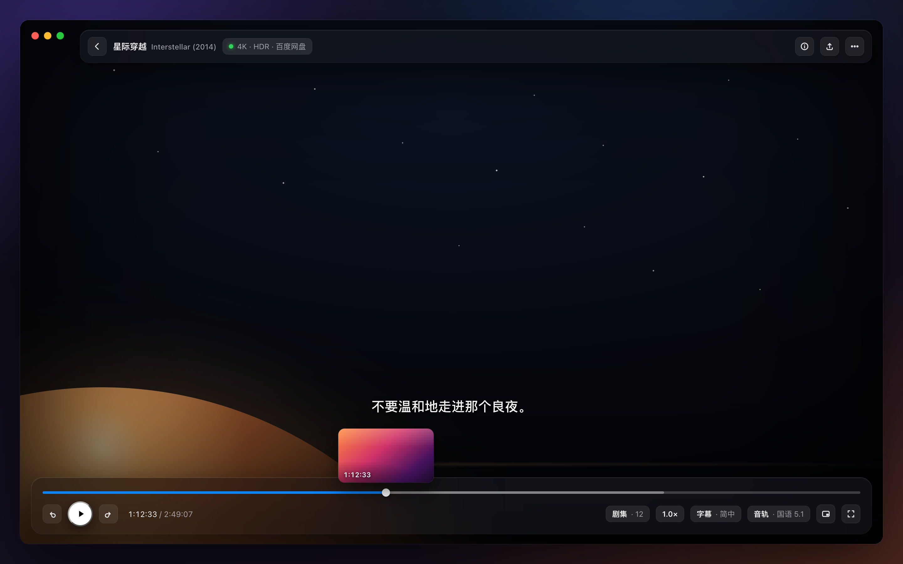
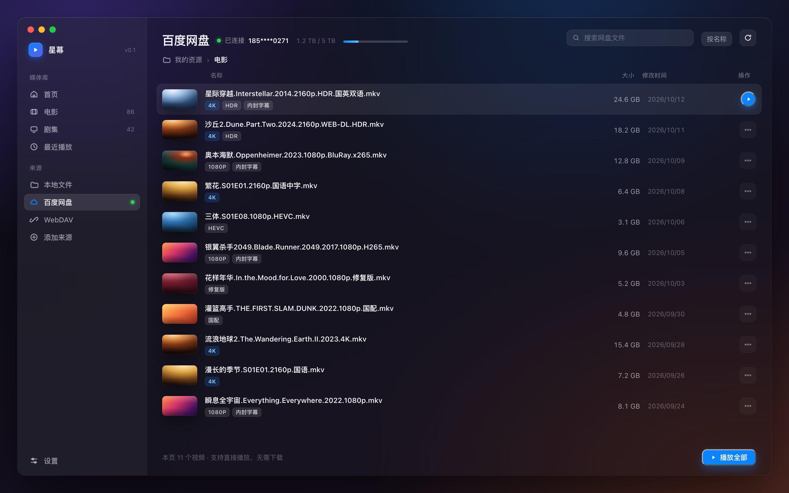

# Lumi

macOS 视频播放器：**本地媒体库 + 百度网盘直连播放**，Apple 设计语言，SwiftUI 原生。

> 不下载、不转存、不接触账号密码——直接播放你自己网盘里的视频。



<p align="center">
  
  
</p>

（以上为设计稿；实现细节以代码为准）

## 功能

- **本地媒体库**：拖入文件夹自动扫描；缩略图（MKV 也能出图）；剧集自动归集（`S01E01` / `第3集` / `EP04` / `1x05`）；播放进度记忆与「最近播放」；右键在访达中显示
- **百度网盘直连播放**：通过百度网盘开放平台官方 API，直接串流播放你网盘内的视频（含目录浏览、缩略图、进度记忆）
- **播放内核 [AetherEngine](https://github.com/superuser404notfound/AetherEngine)**：MKV / MP4 / TS / AVI 等容器，H.264 / H.265 / AV1，HDR10 / 杜比视界 / HLG，SRT / ASS / PGS 字幕，多音轨切换，Atmos 直通
- **播放器**：毛玻璃控制层——进度条拖动、±10 秒、0.5×–2× 倍速、字幕/音轨切换、全屏；快捷键 `空格` `←/→` `F` `Esc`

## 下载安装（推荐）

到 [Releases](https://github.com/MikanShanghai/Lumi/releases) 下载最新的 `Lumi-x.x.x-macos.zip`：

1. 解压后把 **Lumi.app** 拖进「应用程序」
2. 首次打开如果提示"无法验证开发者"：在访达里**右键 → 打开**即可（本版本为 ad-hoc 签名，未做 Apple 公证）
3. 首次使用按下面的「连接你的百度网盘」完成一次性配置

构建包为通用二进制（Intel 与 Apple Silicon 均可），要求 **macOS 15+**。

## 从源码构建

**要求**：macOS 15+，Xcode 或 Command Line Tools（Swift 6.3+）

```bash
git clone https://github.com/MikanShanghai/Lumi.git
cd Lumi/Lumi
swift run Lumi
```

首次编译会拉取 AetherEngine 及其二进制依赖（FFmpeg / 杜比视界 / TrueHD / DTS 等，约 1.2 GB），需要几分钟。

打包成 `.app`（含图标与框架、ad-hoc 签名）：

```bash
swift build -c release                                   # x86_64
swift build -c release --triple arm64-apple-macosx15.0   # arm64（可选，用于通用包）
Scripts/package-app.sh                                   # 产出 dist/Lumi.app 与 zip
```

### 连接你的百度网盘（一次性配置）

百度要求「每个应用只服务自己的开发者」，因此 Lumi 采用**自带应用凭证**模式（你的账号、你的应用、你的授权）：

1. 打开 [百度网盘开放平台](https://pan.baidu.com/union/console/applist) 并用百度账号登录；未注册过开发者则点「申请接入」→ 选「个人」（免费）
2. 控制台点「创建应用」：用途选「个人使用」、类型选「软件」，名称/描述随意
3. 打开应用详情，复制 `AppKey` 与 `SecretKey`
4. 打开 Lumi → 左侧「百度网盘」→ 按向导粘贴并点「保存并验证」→ 点「连接百度网盘」完成扫码/验证码授权

凭证与令牌只保存在本机 `~/Library/Application Support/Lumi/`（权限 600），不会写入仓库、不会上传到任何地方。

## 隐私与安全

- 不收集任何数据，无遥测；所有网络请求都直接发生在你的电脑与百度服务器之间
- 授权可随时在[百度授权管理](https://passport.baidu.com/accountbind)撤销；撤销后删除本机令牌即可
- 本项目仅用于播放**你自己有权访问**的内容

## 架构

```
SwiftUI（AppKit 材质窗口 / 自定义控制层）
  └─ AppModel（路由 / 播放会话 / 进度回写）
       ├─ MediaLibrary    本地扫描 · 元数据探测 · 缩略图缓存 · 剧集归集 · 播放记录
       ├─ BaiduProvider   开放平台 OAuth（设备码）· 令牌刷新 · 目录 · dlink
       ├─ StreamProxy     127.0.0.1 本地代理：拼接 access_token + 注入 UA（直连会 403）
       └─ AetherEngine    播放内核（SwiftPM 依赖）
```

实测踩坑记录（都在 README 与代码注释里）：
- dlink 必须手动拼接 `access_token` 且请求头带 `User-Agent: pan.baidu.com`，否则 403 / errno 31045
- URL 一律用 `URLComponents` 构造，手工转义再交给 `URL(string:)` 会二次转义（`%2E` → `%252E`）
- SwiftUI 里对可拉伸图片用 `contentMode: .fill` 放进 ScrollView 会取到无限高度，撑爆布局
- 抽帧性能：本地 ~260ms；网盘 dlink 直连 ~2.4s；经本地代理 ~14s（所以预览帧走直连）

## 路线图

- [ ] 打包正式 `.app`（图标 / 签名 / DMG）
- [ ] 自动连播 / 下一集
- [ ] 媒体库搜索与排序、网盘搜索
- [ ] 系统媒体控制（控制中心 / 媒体键）
- [ ] 音量控制、外挂字幕、字幕样式、画中画
- [ ] 多网盘（阿里云盘 / 夸克 / 115）与 WebDAV

## 许可

本项目代码采用 MIT 许可（见 [LICENSE](LICENSE)）。

依赖说明：[AetherEngine](https://github.com/superuser404notfound/AetherEngine)（LGPL-3.0 + App Store Exception）及其打包的 FFmpeg / 杜比视界 / TrueHD / DTS 等二进制组件，各自遵循其原始许可。
